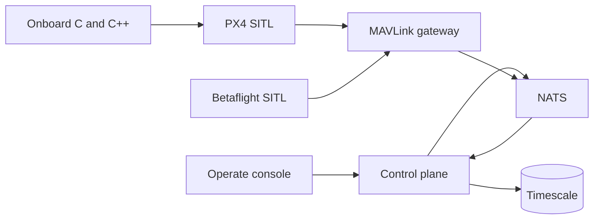

# A2E Mission Cloud

Flight software and an autonomy testbed for small quadcopters. Simulated vehicles fly through PX4 and Betaflight, a MAVLink gateway, and one ground-control screen. The same loop measures GPS-denied navigation, operator-designated visual tracking, and multi-vehicle tasking.

Demo recording, once the six-quad flight is captured: `docs/media/demo.gif`.

## Architecture



The control plane is FastAPI. The gateway is Go. Onboard navigation, tracking, and link logic are C or C++. Governance (OPA, the audit chain, Keycloak, markings) stays in the stack and lives under [docs/governance](docs/governance/control-mapping.md). It is not the product.

The domain has no weapon, payload release, or fire-control type ([ADR 0016](docs/architecture/adrs/0016-no-weapons-in-the-domain.md)). Tracking means an operator-designated object in simulation, with confirm, abort, and timeout written to the audit log.

## Run

```bash
cp .env.example .env
make demo
```

Open `http://localhost:18080`. The dev password is `dev-only-change-me`. Sign in as `gwen.analyst`.

```bash
make test
```

`make test` is the unit suite. `make ci` is lint, OPA, and that suite.

## Results

`make eval` runs the onboard checks and rewrites the table between the markers. Do not edit the numbers by hand.

<!-- eval:start -->

| Metric | Value | Where |
| --- | --- | --- |
| GNSS loss detect | 1.6 s | Phase 2 |
| GNSS step detect | 0.2 s | Phase 2 |
| GNSS drag detect | 17.1 s | Phase 2 |
| Spoof false alarms | 0 per hour | Phase 2 |
| Drift while GNSS denied | 3.00 m/min | Phase 2 |
| Position RMSE while denied | 1.76 m | Phase 2 |
| Re-plan time after vehicle loss | 0.03 µs | Phase 4 |
| Tasks covered after loss | 4 tasks | Phase 4 |
| Guided minimum separation | 20.10 m | Phase 4 |
| Unguided minimum separation | 0.00 m | Phase 4 |
| Link success at 50 m | 0.987 fraction | Phase 5 |
| Link success at 5 km | 0.087 fraction | Phase 5 |
| Link success inside jammer | 0.004 fraction | Phase 5 |
| Lock retention | 50 of 50 runs | Phase 3 |
| Reacquisition | 0.00 frames | Phase 3 |
| Mean pixel error | 0.168 px | Phase 3 |

<!-- eval:end -->
