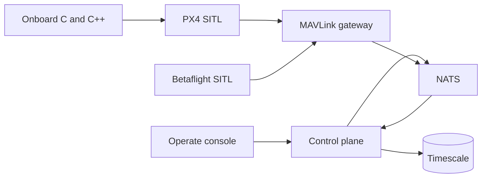

# A2E Mission Cloud

Flight software and an autonomy testbed for small quadcopters. Simulated vehicles fly through PX4 and Betaflight, a MAVLink gateway, and one ground-control screen. The same loop measures GPS-denied navigation, operator-designated visual tracking, and multi-vehicle tasking.

Demo recording, once the six-quad flight is captured: `docs/media/demo.gif`.

## Architecture



The control plane is FastAPI. The gateway is Go. Onboard navigation, tracking, and link logic are C or C++. Governance (OPA, the audit chain, Keycloak, markings) stays in the stack and lives under [docs/governance](docs/governance/control-mapping.md). It is not the product.

The domain has no weapon, payload release, or fire-control type ([ADR 0016](docs/architecture/adrs/0016-no-weapons-in-the-domain.md)). Tracking means an operator-designated object in simulation, with confirm, abort, and timeout written to the audit log.

## Run

```bash
cp .env.example .env
make demo
```

Open `http://localhost:18080`. The dev password is `dev-only-change-me`. Sign in as `gwen.analyst`.

```bash
make test
```

`make test` is the unit suite. `make ci` is lint, OPA, and that suite.

## Results

Filled from `make eval` once a phase has a measured run. Empty cells are not measured yet.

| Metric | Value | Where |
| --- | --- | --- |
| Telemetry latency p50 / p99 | | Phase 1 |
| Telemetry messages per second | | Phase 1 |
| Dropped telemetry messages | | Phase 1 |
| Position drift, GNSS denied | | Phase 2 |
| Spoof time to detect | | Phase 2 |
| Spoof false alarms per flight hour | | Phase 2 |
| Position RMSE vs ground truth | | Phase 2 |
| Lock retention | | Phase 3 |
| Reacquisition time | | Phase 3 |
| Mean pixel error | | Phase 3 |
| Frame to setpoint latency | | Phase 3 |
| Tracker frames per second | | Phase 3 |
| Area coverage vs vehicles | | Phase 4 |
| Re-plan time after vehicle loss | | Phase 4 |
| Minimum separation | | Phase 4 |
| Operator actions per vehicle per minute | | Phase 4 |
| Mission success vs packet loss | | Phase 5 |
| Mission success vs jammer placement | | Phase 5 |
