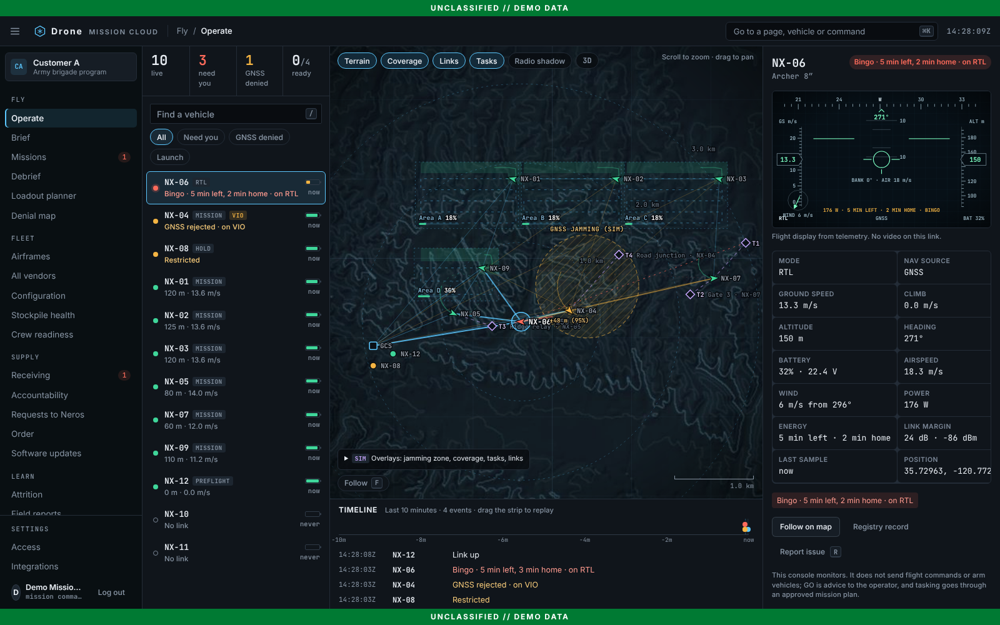
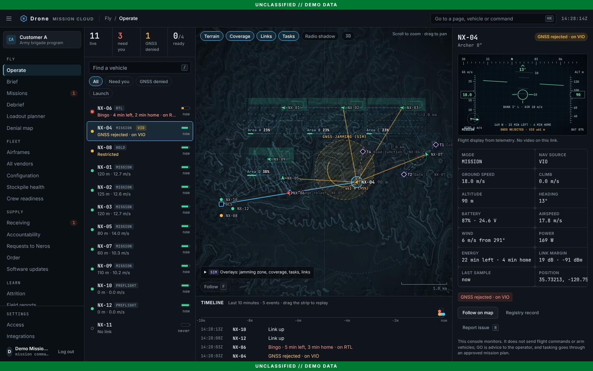
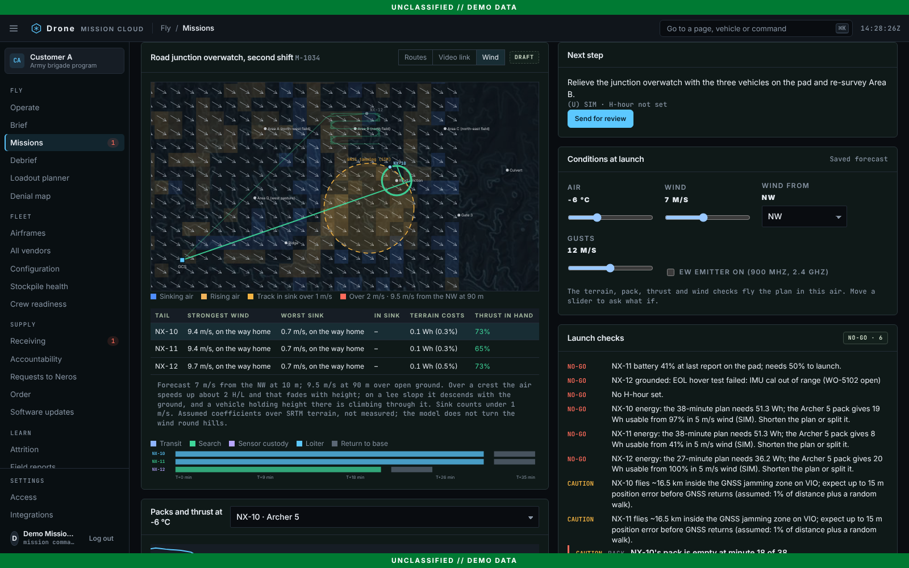
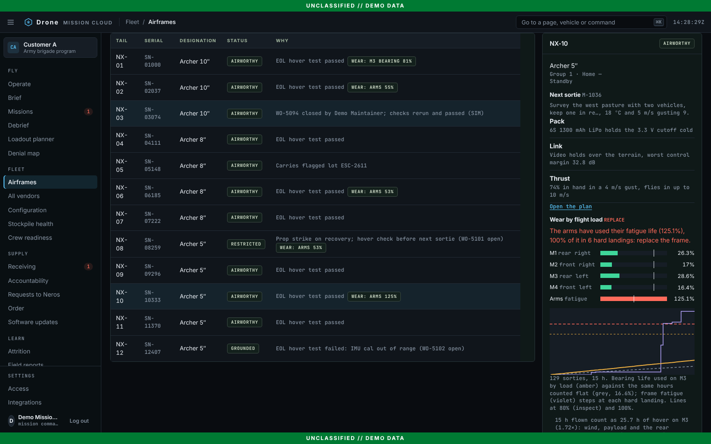
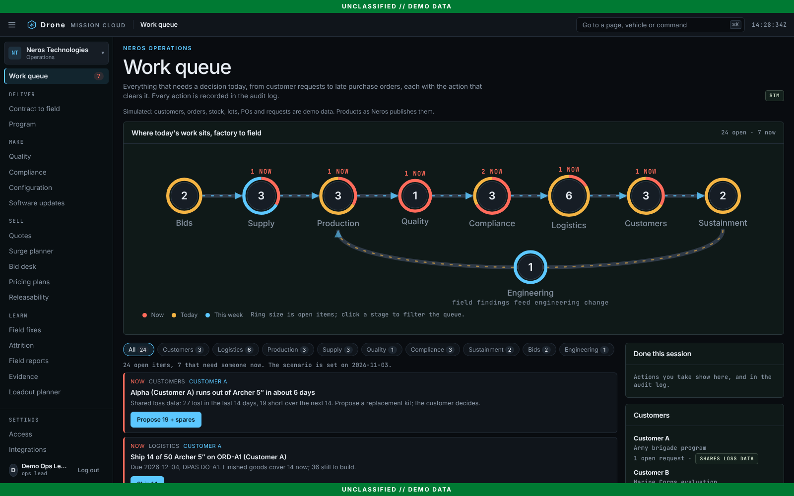
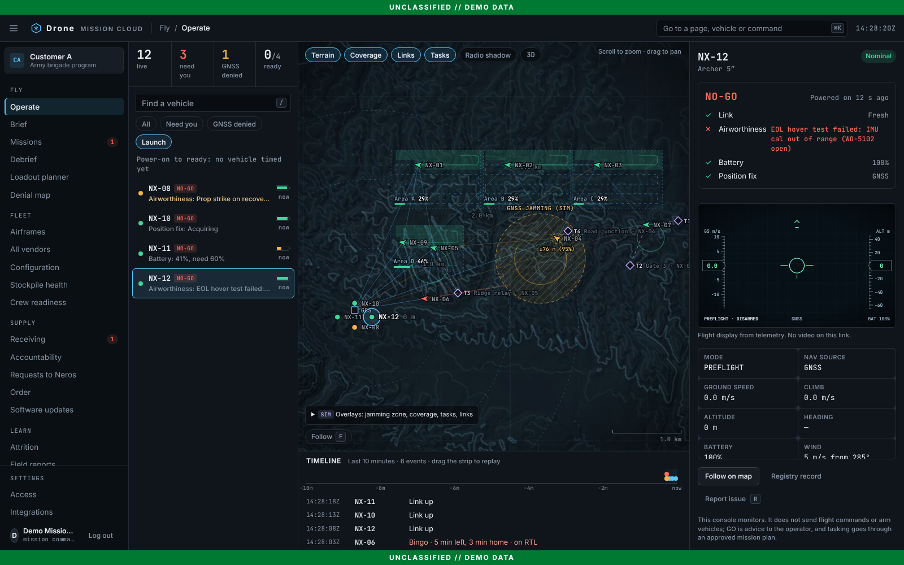
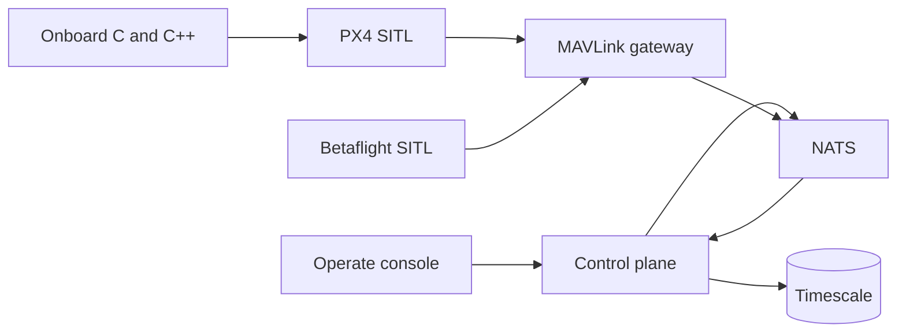

# Drone Mission Cloud

Flight software, an autonomy testbed and a fleet platform for small quadcopters. Simulated vehicles fly through PX4 and Betaflight, a MAVLink gateway, and one ground-control screen. The same loop measures GPS-denied navigation, operator-designated visual tracking, and multi-vehicle tasking.

Around that loop sits one platform with two sides: the manufacturer runs its operations from a work queue, and each customer runs its own fleet, plans against the physics, keeps the per-serial record and asks the maker for resupply. Everything in the hosted demo at drones.productexec.co is simulated and labelled `SIM`.



The console is one Operate screen. Vehicles that need the operator sort to the top with the reason (link lost, GNSS rejected by the spoof gate, low battery). The tactical picture is a local metric plane that needs no map tiles, so it works air-gapped. `⌘K` jumps to any vehicle, page, or filter, and `J`/`K`, `F`, `A`, `L`, and `/` drive it from the keyboard. It monitors; it does not send flight commands.

To see it without the stack:

```bash
cd services/ui && npm ci && npm run build && npm run demo   # http://localhost:4173
```

The demo server plays a scripted sortie, nine vehicles in the air and three on the pad, and marks every page `DEMO DATA`. The local server signs you in as a commander who is also a maintainer and shows every page; the hosted build signs in by role (below).

Every named vehicle in the demo flies one performance model (`demo/physics.mjs`): momentum-theory power against airspeed, a 5 m/s gusting wind it crabs into and slows against, bank-limited turns, a LiPo pack that sags under load, a radio link budget, and a bingo rule that turns it for home when the reserve would not survive the plan. The flight display shows attitude, wind, power and minutes left against minutes home; the same model prices every plan's energy in the launch checks and the debrief, and the Python supervision sweep uses a port of it. All coefficients are assumptions written out in the file, not Neros figures. [Design](docs/design/physics.md).

The map draws the operating picture from the demo scenario, each overlay labelled `SIM`: real terrain baked offline, survey coverage filling in, a GNSS jamming zone with the position error of the vehicle flying on VIO, link quality priced over the terrain (with a Radio shadow layer for where control at 100 m goes thin), and task lines that re-plan when NX-07 drops off the link about every 100 s. Drag the timeline to replay what the console received. For the fleet-scale view, run a second server with `A2E_DEMO_FLEET=300 PORT=4174 npm run demo`. Press **3D** on the map for the same picture in relief: real terrain, each vehicle at its height above ground, the jamming zone as a dome (heights ×2). [Design](docs/design/operating-picture.md).



### Physics where the decision is made



The performance model, a terrain radio model, an electro-thermal pack model, a thrust envelope, wind over terrain, camera optics, pack ageing and wear by flight load each show up on the page where someone acts on them. There is no separate physics page.

| Page | What it adds | Route |
| --- | --- | --- |
| Missions (selected plan) | Conditions at launch (temperature, wind and direction, gusts, EW emitter); findings in Launch checks, each with a fix that re-plans (relay, height, band, preheat, airframe); Routes, Video link and Wind views of the plan map; packs and thrust per tail | `GET/POST /v1/missions/{id}/physics` |
| Brief | What each assigned camera sees of each task by height (pixels on a person, strip width, ground hidden, video margin); the commander sets the height before approval | `POST /v1/intent/height` |
| Loadout planner | Packs and thrust per airframe in the planner's temperature and wind | `GET /v1/envelope` |
| Denial map | Control link and Video link coverage beside the GNSS layer | `GET /v1/coverage` |
| Operate | Station links over terrain, Radio shadow layer, bingo and RTL from the performance model | `GET /v1/physics` |
| Debrief | Where each tail's energy went (lift, blades, drag, climb, wind, cold); link margin over the terrain along the flown track | |
| Airframes | Next sortie's pad needs; wear by flight load (bearing life per motor, arm fatigue) against a flat hours schedule, with ground-for-check | `GET /v1/wear` |
| Stockpile health | Calendar ageing per stored pack, and what a storage charge or a cooler store buys | |

The terrain is real (SRTM); every coefficient is an assumption written out in `services/ui/demo/*.mjs`, not a Neros figure or a flight-test result. [Performance model](docs/design/physics.md), [physics in the pages](docs/design/physics-check.md).



### Product site, help and developers

The hosted build also publishes a product site at `/product/`, a help center at `/help/` and a developer site at `/developers/` (sources in `services/ui/product`, `help`, `developers` and `site`). They run the same scenario engine as the console in the page, so the hero's fleet picture, the per-serial walk-through and the developer API explorer are live demo data, not mock-ups. A first visit to the bare domain lands on `/product/`; deep links such as `/#operate` open the console.

### Hosted demo

`npm run build:static` builds a version with no server: the same scenario code (`demo/scenario.mjs`) answers the console's API calls in the browser. `render.yaml` (a Render Blueprint) builds and publishes it at drones.productexec.co. Add `?fleet=300` to the URL for the fleet-scale view.

The hosted build opens on a sign-in page with six demo accounts:

| Account | Workspace | Lands on |
| --- | --- | --- |
| `admin` | Neros, with a switch to the customer view | Work queue |
| `ops` | Neros operations (ops lead) | Work queue |
| `commander` | Customer A, mission commander and planner | Operate |
| `operator` | Customer A, operator | Operate |
| `maintainer` | Customer A, maintainer | Airframes |
| `allied` | Customer C, an allied tenant: withheld fields never reach the browser | Operate |

The left rail is shaped by role: each person sees the pages their work runs through, grouped (Fly, Fleet, Supply, Learn for a customer; Deliver, Make, Sell, Learn for Neros), with counts of what is waiting on them. Every other page in the workspace is one `⌘K` away, and a button the role cannot use is disabled with the reason. A first visit from an invite link opens a guided walk through the loop. The generated [access matrix](docs/security/demo-access-matrix.md) is what a test holds the demo's rules to.



Passwords are shared out of band, or as a one-link `?invite=` that signs in and removes the token from the address bar; `src/staticDemo.ts` holds only salted SHA-256 hashes. The check runs in the browser because there is no server, so it keeps casual visitors and search engines out (the page is also `noindex`) but is not a security boundary. Demo state lives in the browser tab: it carries across sign-ins and survives a reload, and a new tab or `⌘K` "Reset the demo data" starts fresh. The local `npm run demo` still signs you in automatically.

### Launch readiness



`L` switches the list to vehicles on the ground. Each gets a go or no-go from four checks: a fresh link, airworthiness from the registry, battery at or above 60%, and a position fix (trusted GNSS, or VIO). The row shows the first check that fails, so the operator knows what to fix without opening anything. The console times each vehicle from power-on to GO and keeps the median, which is the case-to-launch metric in the product brief. GO is advice. The console does not arm or launch anything.

### Platform bets

First slices, each measured in sim or unit checks only, not in the field:

- **Supervision at scale**: a fleet sim on the performance model (wind, power curve, pack swaps) that sweeps vehicles per operator and finds where mission success falls off (`make test-scale`). [Design](docs/design/supervision.md), [results](docs/eval/scale.md).
- **Sim gate and flywheel**: a CI scenario gate plus triage that ranks failure modes from SITL runs and logs. [Design](docs/design/sim-gate-flywheel.md).
- **Digital thread**: birth records for each airframe, a pack-health and readiness forecast, and the airworthiness reason shown at launch. [Design](docs/design/digital-thread.md).
- **Contested safety**: a lost-link policy, fleet runs under a jammer, and dense-crossing separation with geofence scenarios. [Design](docs/design/contested-safety.md).
- **Fleet updates**: signed manifests and staged rollouts that halt and roll back a bad build at the canary stage. [Design](docs/design/fleet-updates.md).
- **Training and integration**: scripted training scenarios with an operator scorecard in the demo console, and a conformance test for non-PX4 adapters. [Design](docs/design/training-integration.md).
- **Company view** (`#company`): the Neros product line as published, plus simulated orders, production, supply chain, logistics, sustainment, training and engineering change, joined by SKU and serial. [Design](docs/design/company.md).
- **Two workspaces** (`#ops`, `#supply`): Neros runs its operations from a work queue where every item carries the action that clears it; customers run their own fleets and ask Neros for airframes, spares, training and repairs from a Supply & support portal. Requests, shipments and shared loss data connect the two. [Design](docs/design/workspaces.md).

## Architecture



The control plane is FastAPI. The gateway is Go. Onboard navigation, tracking, and link logic are C or C++. Governance (OPA, the audit chain, Keycloak, markings) stays in the stack and lives under [docs/governance](docs/governance/control-mapping.md). It is not the product.

The domain has no weapon, payload release, or fire-control type ([ADR 0016](docs/architecture/adrs/0016-no-weapons-in-the-domain.md)). Tracking means an operator-designated object in simulation, with confirm, abort, and timeout written to the audit log.

## Run

```bash
cp .env.example .env
make demo
```

Open `http://localhost:18080`. The dev password is `dev-only-change-me`. Sign in as `gwen.analyst`.

```bash
make test
```

`make test` is the unit suite. `make ci` is lint, OPA, and that suite.

The console has its own checks in `services/ui`: `npm run e2e` (Playwright, including an axe accessibility gate on fifteen pages), `node --test demo/*.test.mjs` for the scenario engine and access rules, and the persona journey swarm (`e2e/swarm/README.md`), a bot per demo account that walks the site, signs in and presses every button on every page at laptop and phone widths. `node e2e/docs/shots.mjs` retakes the screenshots in this README, the product site and the help center from the current build.

## Results

`make eval` runs the onboard checks and rewrites the table between the markers. Do not edit the numbers by hand.

Each row says where it was measured. **Unit check** rows come from the onboard C tests: the module runs open loop against a synthetic or recorded stream. **PX4 SITL** rows come from `make sitl`: PX4 v1.18 flies in SIH with its own EKF2 and controllers, and the onboard code closes the loop through MAVLink ([method](docs/design/sitl.md), [full results](docs/eval/sitl.md)).


<!-- eval:start -->

| Metric | Value | Measured in | Phase |
| --- | --- | --- | --- |
| GNSS loss detect | 1.6 s | Unit check | Phase 2 |
| GNSS step detect | 0.2 s | Unit check | Phase 2 |
| GNSS drag detect | 17.1 s | Unit check | Phase 2 |
| Spoof false alarms | 0 per hour | Unit check | Phase 2 |
| Drift while GNSS denied | 3.00 m/min | Unit check | Phase 2 |
| Position RMSE while denied | 1.76 m | Unit check | Phase 2 |
| Error after 120 s without GNSS, GNSS only | 374.9 m | PX4 SITL | Phase 2 |
| Error after 120 s without GNSS, with VIO and gate | 3.4 m | PX4 SITL | Phase 2 |
| Drift without GNSS, with VIO and gate | 1.24 m/min | PX4 SITL | Phase 2 |
| Error after 120 s of spoofed drag, no gate | 7.9 m | PX4 SITL | Phase 2 |
| Error after 120 s of spoofed drag, with gate | 4.3 m | PX4 SITL | Phase 2 |
| Spoofed drag caught within | 25.5 s, worst run | PX4 SITL | Phase 2 |
| Spoofed 50 m step caught within | 0.54 s, worst run | PX4 SITL | Phase 2 |
| GNSS dropped in clean or multipath flight | 0 times | PX4 SITL | Phase 2 |
| Re-plan latency after vehicle loss | 1313 ms at 10 Hz | Unit check | Phase 4 |
| Tasks held by two vehicles | 0 in 500 lossy runs | Unit check | Phase 4 |
| Tasks covered after loss | 4 tasks | Unit check | Phase 4 |
| Guided minimum separation | 20.10 m | Unit check | Phase 4 |
| Unguided minimum separation | 0.00 m | Unit check | Phase 4 |
| Link success at 50 m | 0.987 fraction | Unit check | Phase 5 |
| Link success at 5 km | 0.087 fraction | Unit check | Phase 5 |
| Link success inside jammer | 0.004 fraction | Unit check | Phase 5 |
| Fleet sorties completed under jammer, default failsafe | 0.671 fraction | Unit check | Phase 5 |
| Fleet sorties completed under jammer, mesh and lost-link policy | 1.000 fraction | Unit check | Phase 5 |
| Dense crossing minimum separation | 5.97 m | Unit check | Phase 4 |
| Dense crossing losses of separation | 0 events | Unit check | Phase 4 |
| Dense crossing geofence breaches | 0 events | Unit check | Phase 4 |
| Lock retention | 50 of 50 runs | Unit check | Phase 3 |
| Reacquisition | 0.00 frames | Unit check | Phase 3 |
| Mean pixel error, synthetic checkerboard shifts (sanity check; real imagery is the SITL rows below) | 0.000 px | Unit check | Phase 3 |
| Frames on target, tracker v1, median run | 0.180 fraction | PX4 SITL | Phase 3 |
| Frames on target, tracker v2, median run | 0.984 fraction | PX4 SITL | Phase 3 |
| Runs that held the target, tracker v1 | 0 of 5 runs | PX4 SITL | Phase 3 |
| Runs that held the target, tracker v2 | 3 of 5 runs | PX4 SITL | Phase 3 |
| Follow error, tracker v2, median run | 1.8 m | PX4 SITL | Phase 3 |

<!-- eval:end -->
