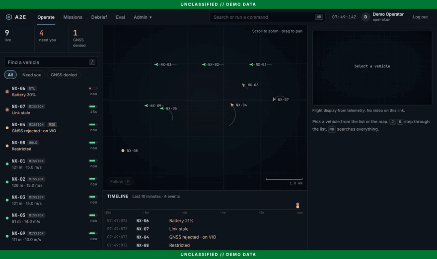
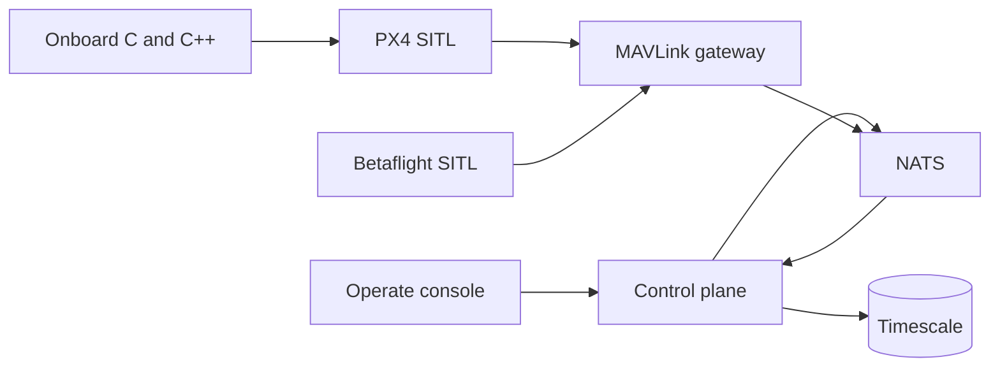
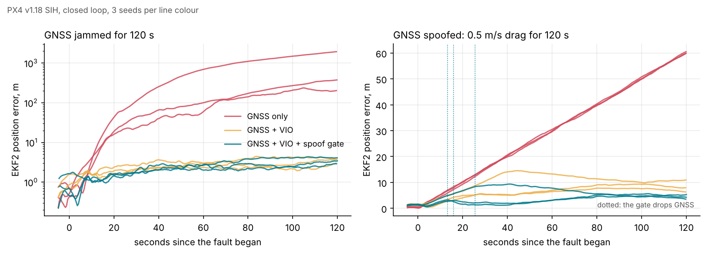

# A2E Mission Cloud

Flight software and an autonomy testbed for small quadcopters. Simulated vehicles fly through PX4 and Betaflight, a MAVLink gateway, and one ground-control screen. The same loop measures GPS-denied navigation, operator-designated visual tracking, and multi-vehicle tasking.



The console is one Operate screen. Vehicles that need the operator sort to the top with the reason (link lost, GNSS rejected by the spoof gate, low battery). The tactical picture is a local metric plane that needs no map tiles, so it works air-gapped. `⌘K` jumps to any vehicle, page, or filter, and `J`/`K`, `F`, `A`, and `/` drive it from the keyboard. It monitors; it does not send flight commands.

To see it without the stack:

```bash
cd services/ui && npm ci && npm run build && npm run demo   # http://localhost:4173
```

The demo server plays a scripted nine-vehicle sortie and marks every page `DEMO DATA`.

## Architecture



The control plane is FastAPI. The gateway is Go. Onboard navigation, tracking, and link logic are C or C++. Governance (OPA, the audit chain, Keycloak, markings) stays in the stack and lives under [docs/governance](docs/governance/control-mapping.md). It is not the product.

The domain has no weapon, payload release, or fire-control type ([ADR 0016](docs/architecture/adrs/0016-no-weapons-in-the-domain.md)). Tracking means an operator-designated object in simulation, with confirm, abort, and timeout written to the audit log.

## Run

```bash
cp .env.example .env
make demo
```

Open `http://localhost:18080`. The dev password is `dev-only-change-me`. Sign in as `gwen.analyst`.

```bash
make test
```

`make test` is the unit suite. `make ci` is lint, OPA, and that suite.

## Results

`make eval` runs the onboard checks and rewrites the table between the markers. Do not edit the numbers by hand.

Each row says where it was measured. **Unit check** rows come from the onboard C tests: the module runs open loop against a synthetic or recorded stream. **PX4 SITL** rows come from `make sitl`: PX4 v1.18 flies in SIH with its own EKF2 and controllers, and the onboard code closes the loop through MAVLink ([method](docs/design/sitl.md), [full results](docs/eval/sitl.md)).



<!-- eval:start -->

| Metric | Value | Measured in | Phase |
| --- | --- | --- | --- |
| GNSS loss detect | 1.6 s | Unit check | Phase 2 |
| GNSS step detect | 0.2 s | Unit check | Phase 2 |
| GNSS drag detect | 17.1 s | Unit check | Phase 2 |
| Spoof false alarms | 0 per hour | Unit check | Phase 2 |
| Drift while GNSS denied | 3.00 m/min | Unit check | Phase 2 |
| Position RMSE while denied | 1.76 m | Unit check | Phase 2 |
| Error after 120 s without GNSS, GNSS only | 374.9 m | PX4 SITL | Phase 2 |
| Error after 120 s without GNSS, with VIO and gate | 3.4 m | PX4 SITL | Phase 2 |
| Drift without GNSS, with VIO and gate | 1.24 m/min | PX4 SITL | Phase 2 |
| Error after 120 s of spoofed drag, no gate | 7.9 m | PX4 SITL | Phase 2 |
| Error after 120 s of spoofed drag, with gate | 4.3 m | PX4 SITL | Phase 2 |
| Spoofed drag caught within | 25.5 s, worst run | PX4 SITL | Phase 2 |
| Spoofed 50 m step caught within | 0.54 s, worst run | PX4 SITL | Phase 2 |
| GNSS dropped in clean or multipath flight | 0 times | PX4 SITL | Phase 2 |
| Re-plan latency after vehicle loss | 1313 ms at 10 Hz | Unit check | Phase 4 |
| Tasks held by two vehicles | 0 in 500 lossy runs | Unit check | Phase 4 |
| Tasks covered after loss | 4 tasks | Unit check | Phase 4 |
| Guided minimum separation | 20.10 m | Unit check | Phase 4 |
| Unguided minimum separation | 0.00 m | Unit check | Phase 4 |
| Link success at 50 m | 0.987 fraction | Unit check | Phase 5 |
| Link success at 5 km | 0.087 fraction | Unit check | Phase 5 |
| Link success inside jammer | 0.004 fraction | Unit check | Phase 5 |
| Lock retention | 50 of 50 runs | Unit check | Phase 3 |
| Reacquisition | 0.00 frames | Unit check | Phase 3 |
| Mean pixel error | 0.000 px | Unit check | Phase 3 |
| Frames on target, tracker v1, median run | 0.180 fraction | PX4 SITL | Phase 3 |
| Frames on target, tracker v2, median run | 0.984 fraction | PX4 SITL | Phase 3 |
| Runs that held the target, tracker v1 | 0 of 5 runs | PX4 SITL | Phase 3 |
| Runs that held the target, tracker v2 | 3 of 5 runs | PX4 SITL | Phase 3 |
| Follow error, tracker v2, median run | 1.8 m | PX4 SITL | Phase 3 |

<!-- eval:end -->
