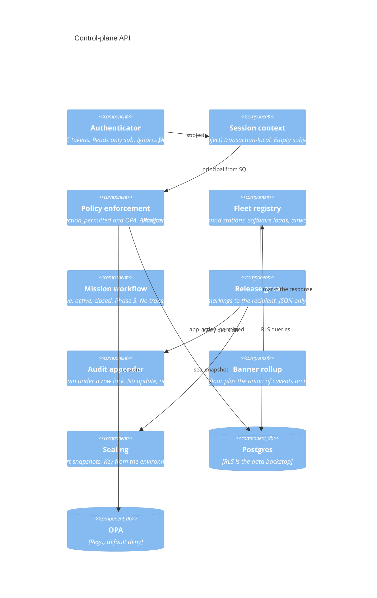

# C4 — components

## Control-plane API

The API role cannot `SET` its way past RLS into another tenant's rows without also being able to impersonate a subject. That credential is a trust boundary, documented in [ADR 0024](adrs/0024-database-role-trust-boundary.md). Application bugs that forget a `WHERE tenant_id = ...` still return zero foreign rows.

## Telemetry gateway (Phase 2)

- MQTT subscriber per vehicle tenant topic `a2e/v1/{tenant}/{tail}/telemetry`.
- JSON Schema validation. Unknown fields dropped, invalid samples rejected and counted.
- Per-tail rate limit at 5 Hz sustained, burst 10. Over-rate samples are counted and discarded, not queued without bound.
- JetStream publish with tenant and tail headers.
- Redis `HSET` of the latest sample for the UI path.
- Timescale writer consumes JetStream in batches for history.
- WebSocket hub sends at most 2 Hz per viewport, clustered above 500 tails in view. The p99 target is ingest to that fan-out under 2 seconds, not 50,000 browser messages per second.

## Autonomy runtime (Phase 3)

`AutonomyRuntime` is a Python `Protocol` and a matching protobuf service: `Load`, `Configure`, `Start`, `Stop`, `Status`, `Watch`. `SimRuntime` implements it in-process. `FantomRuntime` is a stub whose method bodies are `# STUB: FANTOM Core SDK call` and return `Unavailable`. Behaviors ship as signed OCI images plus a manifest (version, inputs, outputs, required services, resource limits, safety constraints, promotion state).

Safety constraints in every reference manifest include `weapons_interface: forbidden` and `human_approval_required: true`. The loader rejects a manifest that does not say both.

## Video plane (Phase 4)

MediaMTX terminates RTSP/SRT. A KLV parser (STANAG 4609 / MISB ST 0601) writes frame metadata onto the track bus at full rate. Pixels are proxied or transcoded to HLS only for streams the video manager assigned bandwidth. The manager's inputs are mission state, consumer need, and a link budget. It never infers a weapons cue from the video.

## Edge agent (Phase 6)

An ordered operation log, not multi-master row copy. Telemetry and audit append. Mission plans that diverged during the disconnect are frozen until a commander resolves them. Fleet custody rejects a fork until an officer reconciles the chain. Default disconnect budget is 72 hours.
