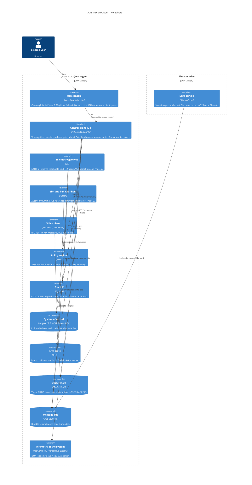

# C4 — containers

A container here is a deployable process or data store, not a Docker image. Every one of these starts from `docker compose up` on a laptop. Kubernetes manifests arrive with the component that needs them; the full multi-region chart is Phase 6. Phase 1 ships a chart for the control plane.

Active-active is the stateless tier (API, gateway, OPA). A tenant's mission writes are pinned to a home region. Telemetry is born in the theater and replicates inward. See [ADR 0019](adrs/0019-active-active-and-edge.md).

Laptop Compose speaks HTTP. TLS 1.2+ with the approved cipher list is the ingress config in `deploy/nginx/nginx.conf` and the Helm chart, not an optional extra. See [ADR 0020](adrs/0020-fips-crypto.md).
