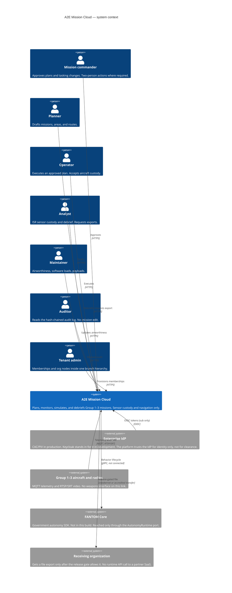

# C4 — system context

There is no arrow to a map CDN, weather API, identity SaaS, or log SaaS. Forecasts arrive as GRIB2 files on disk. Map tiles are files on disk. Logs stay in the enclave. That is [ADR 0021](adrs/0021-air-gap-and-no-runtime-saas.md).

Coalition users are people inside the same system, admitted by a sharing agreement and a `REL TO` marking. They are not a separate integration.
