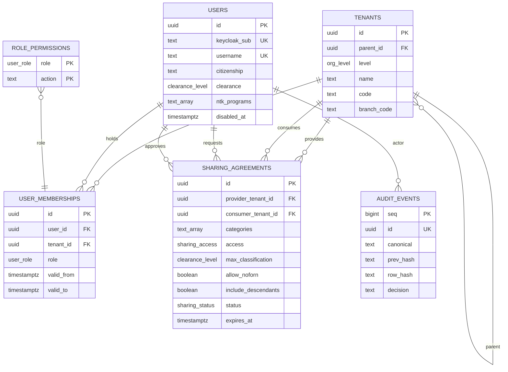
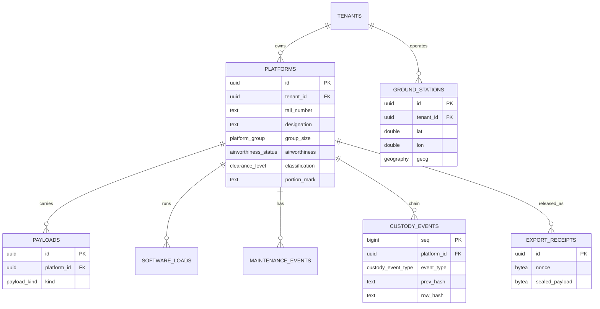
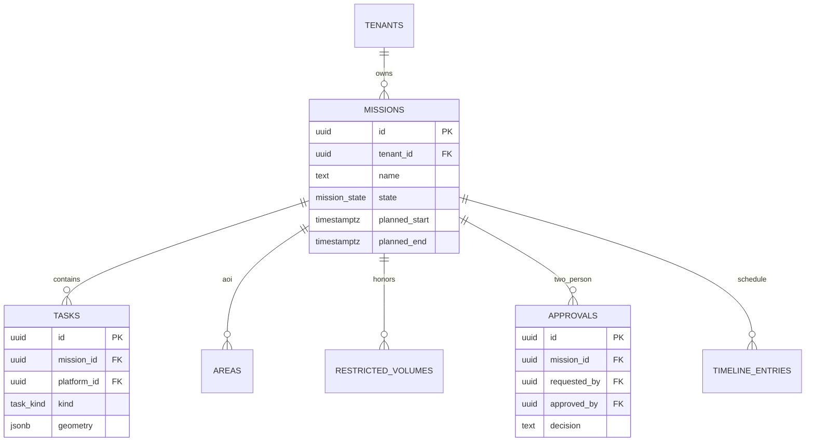

# Data model

Physical tables in Phase 1 are the tenancy, marking, audit, sharing, fleet, and export-receipt entities. Mission, telemetry, video, behavior, and edge tables are specified here so later phases migrate forward instead of inventing a second tenant key. They are marked **logical**.

Every tenant-owned row carries:

| Column | Meaning |
| --- | --- |
| `tenant_id` | Owning org node, usually a team |
| `classification` | `UNCLASSIFIED`, `CUI`, `CONFIDENTIAL`, `SECRET`, `TOP_SECRET` |
| `caveats` | `NOFORN` and/or `REL TO …`. Any other token fails closed |
| `ntk_programs` | Empty means no extra program. Non-empty means the reader must intersect |
| `portion_mark` | Trigger-maintained, for example `(CUI//NOFORN)` |

The banner is not a column. The API computes it per response. Floor is the system high. Caveats are the union of caveats on the rows in that response. See [ADR 0023](adrs/0023-classification-portion-marks-banners.md).

## Organization and identity

`tenants.level` is `branch → command → unit → team`. A branch has no parent. Every other node has a parent of the level above it, enforced by a trigger.

A membership at a node covers that node and its descendants. It does not cover siblings or a parent. A wing admin sees the wing's teams. A team operator does not see the sister team.

Sharing is read-only in this build even if `access` is stored as `read_write`. The consumer sees the provider tenant named on the agreement, not its children, unless `include_descendants` is true. Category `audit` cannot appear. Term at most 365 days. Status moves `draft → active → revoked`. Terms do not change in place.

The system user (`username = system`) exists so authentication failures have an actor. It is disabled and has no memberships.

`system_policy` is a single row: `system_high` and `max_release`. This build allows only `UNCLASSIFIED` or `CUI`, and the API refuses to start if the row and the configuration disagree. The app role cannot update the row.

## Fleet (Phase 1, physical)

`platform_group` is `group_1 | group_2 | group_3`. `payload_kind` is `eo | ir | eo_ir | sar | lidar | comms_relay | acoustic`. There is no weapon, store, or effector value. Adding one is a schema change an assessor can see.

Custody is a per-tail hash chain of `accept | transfer | release | inventory`. It records who has the aircraft inside the owning tenant. It does not move `tenant_id`. Cross-tenant transfer is not implemented.

`ground_stations.geog` is a generated PostGIS geography so the extension is on the path Phase 2's map queries will use. TimescaleDB is created in Phase 1 and first used as a hypertable in Phase 2.

Export receipts store AES-256-GCM ciphertext, not the plaintext snapshot. Associated data is the tenant id and resource id.

## Missions (Phase 5, logical)

`mission_state` moves `draft → review → approved → active → closed`. No skip. `approved_by` differs from `requested_by`. `task_kind` will be `transit | search | sensor_custody | loiter | rtb`. It will not include employment or release.

Restricted volumes are polygons with altitude floors and ceilings, including overhangs the 3D planner treats as solid. Areas of interest are the search and custody regions.

## Telemetry and tracks (Phase 2, logical)

`telemetry_samples` is a Timescale hypertable: `time, platform_id, tenant_id, lat, lon, alt_m, vel, heading, source`. Latest value also lives in Redis. `tracks` and `track_points` are sensor-custody products: a track id, a quality score, an estimated position, and the tail that holds custody. They are not fire-control tracks.

## Behaviors and sim (Phase 3, logical)

`behavior_packages`: digest, signature, manifest JSON, promotion (`sim_validated | hitl_validated | flight_cleared`), version. `regression_baselines`: coverage, custody, energy, constraint violations, replans, per version. `sim_runs`: scenario file, seed, vehicle count, scorecard.

The manifest fields are version, inputs, outputs, required services, cpu/memory limits, and safety constraints (`weapons_interface = forbidden`, `human_approval_required = true`, geofence required).

## Video (Phase 4, logical)

`video_streams`: tenant, platform, publisher credential hash, protocol (`rtsp | srt`), HLS path. `klv_frames`: time, stream id, frame number, sensor footprint polygon, platform position copied from the KLV security set. Checksum failures are not inserted.

## Edge and metering (Phase 6 and ops, logical)

`sync_cursors`: node id, stream, last acked sequence. `sync_conflicts`: plan or custody forks waiting on a person. `usage_meters`: tenant, day, simulated flight-seconds, video-egress bytes, export count. Metering is for billing a tenant, not for cross-tenant analytics.

## Indexes and RLS shape

Phase 1 indexes: `tenants(parent_id)`, `users(keycloak_sub)`, `users(username)`, `user_memberships(user_id)`, `platforms(tenant_id)`, unique `(tenant_id, tail_number)`.

RLS policies call `SECURITY DEFINER` functions. Those functions read `current_setting('app.subject')` and do not take a caller-supplied user id. Policies are `FORCE`d. The API user is not a superuser and does not have `BYPASSRLS`.

Visible fleet row =

1. marking is at or below system high, and
2. the reader's clearance dominates the row, and
3. caveats are understood and the reader's citizenship passes them, and
4. NTK intersects when the row lists programs, and
5. the row's tenant is in the reader's hierarchy, or an active sharing agreement names it for category `fleet`.

Writes additionally require `fleet.write` on a hierarchy membership. Sharing never grants a write in this build.
