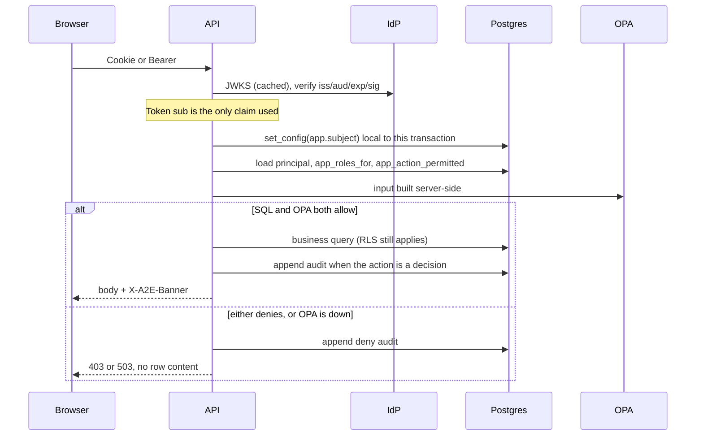
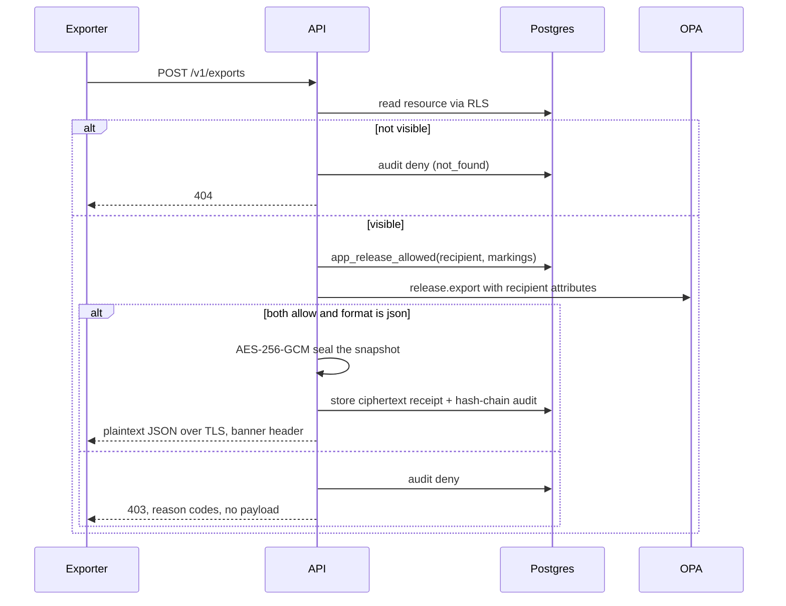
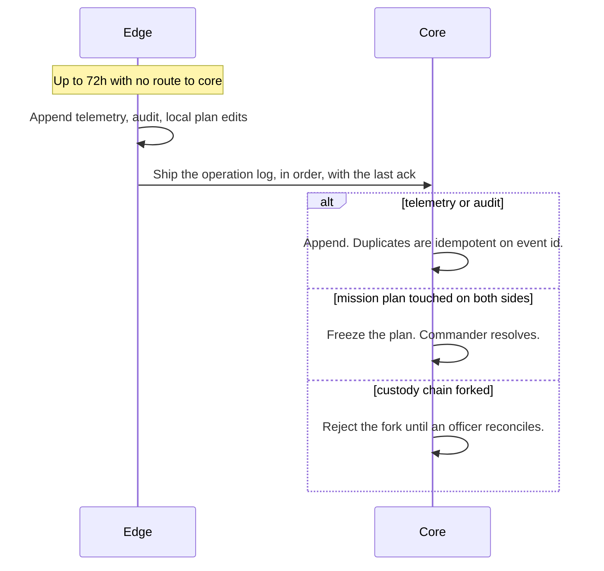

# Sequences

## Request authorization

A missing `app.subject` yields no rows. A failed OPA call yields no rows. The banner floor is the system high (`CUI` in this build) so a screen is never painted below the accreditation level. Caveats are added from the rows actually returned.

## Release

The recipient is a principal the exporter is allowed to name (same hierarchy, or the other side of an active sharing agreement). Unknown recipient and unauthorized recipient return the same denial. PDF, CSV, and xAPI are specified for Phase 5; this build refuses them after the authorization check so the attempt is still audited.

## Edge reconnect (Phase 6)

