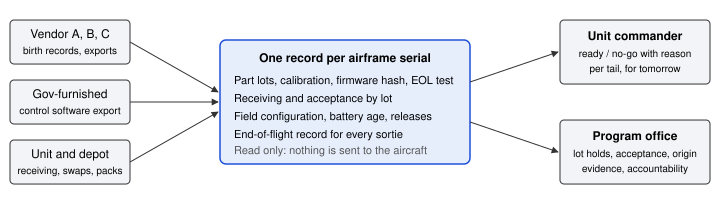

<!--
SOURCE FOR THE SUBMITTED PDF. Build with ./build.sh. Fields in [[double brackets]]
are Kevin's to fill in the local copy before building (see README.md, "Kevin's steps").
Do not commit real phone numbers, revenue or pipeline figures to this public repo.
-->

::: {.titlepage}

**This Solution Brief includes data that shall not be disclosed outside the Government, except to non-Government personnel for evaluation purposes, and shall not be duplicated, used, or disclosed -- in whole or in part -- for any purpose other than to evaluate this submission. If, however, an agreement or contract is awarded to this Company as a result of -- or in connection with -- the submission of this data, the Government shall have the right to duplicate, use, or disclose the data to the extent agreed upon by both parties in the resulting Agreement. This restriction does not limit the Government's right to use the information contained in this data if it is obtained from another source without restriction. The data subject to this restriction are contained on pages 2 through 6.**

# Drone Mission Cloud

## A serial-level readiness and supply record for mixed-vendor small UAS fleets

Solution Brief submitted under the Department of War Drone Marketplace Commercial Solutions Opening, W58RGZ-26-S-C001, Method 1: Innovative Warfighter Solutions.

| | |
|---|---|
| **Area of Interest** | Supply Chain and Logistics |
| **Related AOI** | Software (Command & Control). Not a separate concept; noted for routing only. |
| **Company** | Product Exec, Co. |
| **UEI / CAGE** | Q5QZKYEU6CZ8 / 26U91 |
| **Point of contact** | Kevin Owens, [[title]] |
| **E-mail / Phone** | [[email]] / [[phone]] |
| **Address** | [[street, city, state, ZIP]] |
| **Date** | [[submission date]] |
| **Program / Government POC** | PMO UAS, CPE Aviation (SFAE-AVN-U). Individual POC not known. |
| **Proposed NAICS** | 513210, Software Publishers (size standard $47.0M). Alternate: 541511, Custom Computer Programming Services ($34.0M). |
| **Business size** | Small business under the proposed NAICS. |
| **Proposed instrument** | Fixed-price prototype OT (10 U.S.C. 4022) or FAR Part 12 firm-fixed-price. |

All submission content is UNCLASSIFIED. No PII or PHI is included.

:::

# 1. Executive summary {.restricted}

The Drone Marketplace lets units buy small UAS from many vendors. That choice creates a records problem the Marketplace does not yet solve: once a formation flies three or four vendors' airframes, nobody can answer, from one place, which tails are ready tomorrow, which are grounded and why, which carry a component lot that failed elsewhere, whose batteries are past age limits, which parts lack the origin evidence that sourcing rules require, and where every expended attritable airframe went.

**Drone Mission Cloud** is commercial software that keeps one record per airframe serial, from the factory bench to the end of its last flight, across vendors. It joins the birth record (part lots, calibration, firmware hash, end-of-line test), receiving and acceptance, field configuration changes, battery age, software releases, and an end-of-flight record for every sortie. From that record it gives a unit commander a readiness answer with a reason on every tail, and gives the program office supply-chain views: lot holds, acceptance by lot, origin evidence, and accountability for every expended serial.

It does not fly the aircraft. It reads from vendor ground control software and government-furnished control software, sends nothing back, and has no weapons, targeting or release functions by design. It installs air-gapped on government infrastructure as a container bundle with no runtime cloud dependency.

We propose a fixed-price, 6-month prototype with one formation that already flies at least two vendors' Marketplace airframes: import their fleet, run readiness and accountability from the record, and measure three outcomes against the unit's current method (Section 3).

# 2. High-level solution and concept {.restricted}

**The capability gap.** Mixed-vendor buying moves record keeping onto the unit. Each vendor ships its own app, log format and spares process. Attritable airframes are expended in numbers that make paper accountability unworkable. Field reconfiguration (swapping arms, motors, batteries or payloads between airframe sizes) makes the as-built record stale on the day it changes. Battery and component sourcing rules, including the FY25 NDAA §848 flight-critical component provisions and the battery restrictions that take effect in October 2027, need lot-level evidence, not vendor attestations alone.

**What is unique.** Most fleet tools are tied to one vendor's aircraft or one ground station. Drone Mission Cloud keys everything to the airframe serial and treats every vendor as an import with checks:

{width=100%}

- **Readiness with a reason.** Every tail gets go or no-go from four checks (fresh link, airworthiness from the record, battery at or above threshold, trusted position fix). The first failing check is shown in words, for example "EOL hover test failed: IMU calibration out of range", so a maintainer knows what to fix without opening anything.
- **Lot holds that reach the flight line.** A quality hold on a component lot immediately grounds every serial that carries it, in every unit, and lifts when the lot is released.
- **Acceptance and receiving by lot.** Receiving inspection results roll up to acceptance rate and first-pass yield per lot and per vendor.
- **Accountability for attritable airframes.** Every expended serial ties to the sortie it ended on, with a neutral outcome (completed, aborted, lost). A loss autopsy looks for lots and configurations that end sorties more often than the fleet.
- **Configuration control in the field.** A conversion is checked against the vendor's rules and holds the airframe from ready until its parameter set is loaded.
- **Stockpile health.** Over-age battery packs hold their airframe from ready; rotating the pack restores it.
- **Signed software releases.** Firmware and software updates are signed, staged by canary, and halt and roll back automatically on a bad build.
- **Origin evidence.** Each component lot carries its origin documents; missing evidence shows as a gap with its owner and date.
- **Mixed-vendor import.** Fleets come in from vendor exports and from government-furnished control software exports. Every row is validated, and a tail without a birth record says so instead of looking ready.

**How it scales.** The record is one row per serial plus append-only events, so it grows with airframes and sorties, not users. Telemetry ingest is a Go gateway on a message bus (NATS and MQTT); the control plane is FastAPI on PostgreSQL with PostGIS and TimescaleDB, with row-level security per tenant and a hash-chained audit log of decisions. A fleet simulation runs the console at 300 vehicles. Multi-tenant separation lets a brigade see its battalions while each battalion sees only its own fleet; a releasability layer withholds fields from allied tenants at the API.

**Feasibility and team.** The software runs today in two forms. The production service (FastAPI control plane, Go telemetry gateway, PostgreSQL record, Helm chart for an air-gapped install) carries birth records, readiness, signed staged releases and the audit log. The supply-chain views listed above (lot holds, receiving, accountability, configuration, stockpile, origin evidence, mixed-vendor import) run end to end in the demonstration build on simulated fleet data, with tests for each rule; moving them into the production service is part of milestones M1 and M2. It is built and maintained by Product Exec, Co., led by Kevin Owens, [[one sentence: product leadership background and relevant prior delivery]]. [[Add any other named team members, or state that the company will add one engineer for the prototype.]] The codebase has automated tests for every security decision, a role-and-permission matrix enforced in tests, and an accessibility check in continuous integration.

**Commercial technology, pilot not development.** This is a pilot and demonstration of existing commercial software adapted to Army fleets. The adaptation is import adapters for the formation's specific vendors and integration with the unit's chosen identity provider.

**Technical readiness: TRL 4.** Components are validated in a laboratory environment: navigation fault handling and tracking in closed-loop PX4 software-in-the-loop runs, fleet behaviour and every supply-chain rule on simulated data. It has not yet run on a unit's real fleet data, and no figure in this brief is a field result. **Path to maturity:** TRL 5 at month 2, with the formation's real fleet imported into a government-hosted instance; TRL 6 at month 5, with readiness and accountability used in a field exercise. Proprietary aspects: the readiness and accountability logic, the loss-autopsy method and the import validators (see the IP statement).

**Security posture.** Designed for disconnected operation: no runtime outbound call to any SaaS, OIDC sign-in built to sit behind the enterprise IdP for CAC/PIV, a FIPS-validated crypto module planned for the production image, OPA policy plus database row-level security, portion marking and banners, and a starter System Security Plan with a plan of action and milestones. Government data stays on government infrastructure in the United States, which satisfies the CSO's data storage requirement without a commercial cloud.

# 3. Rough order of magnitude and schedule {.restricted}

**ROM: $[[total]] firm-fixed-price, 6 months, one formation.** Assumptions are annotated.

| Milestone | Month | Deliverable | Payment |
|----------|--|----------------------------|---|
| M1. Install and import | 1 | Air-gapped install on a government-provided host; supply-chain views in the production service; the formation's fleet imported from vendor exports with a validation report | $[[m1]] |
| M2. Readiness live | 2 | Readiness with reasons for every tail; lot holds; receiving by lot (TRL 5) | $[[m2]] |
| M3. Accountability and stockpile | 3 | End-of-flight records for every sortie; battery age holds; origin evidence gaps listed | $[[m3]] |
| M4. Field exercise | 5 | Used in one exercise; operators trained; measured results (TRL 6) | $[[m4]] |
| M5. Results and transition | 6 | Report on the three measures below; production pricing; transition plan | $[[m5]] |

**Measures, set with the unit at M1.** (1) Minutes for a commander to get a trusted ready count for tomorrow, against the unit's current method. (2) Share of expended serials accounted for within 24 hours. (3) Days from a component lot failing to every affected tail being held.

**ROM assumptions.** [[n]] full-time-equivalent staff for 6 months at a fully loaded rate of $[[rate]] per hour; the Government provides the host (a server or virtual machine in a government facility) and network access to vendor exports; one formation of up to 300 airframes from up to four vendors; travel for two site visits; no classified work; no hardware purchased. Evaluation and proposal costs are excluded, as the CSO requires.

**After the prototype.** Production pricing is per formation per year with interfaces free, so units are never charged to connect another vendor. [[Optional: indicative annual price per formation.]]

# 4. Company viability {.restricted}

**Commercial traction.** [[State honestly: revenue to date, paying customers or pilots, letters of interest, and the sales pipeline with stage and value. If pre-revenue, say so and state the pipeline.]]

**Corporate and financial stability.** Product Exec, Co. is registered in SAM.gov (UEI Q5QZKYEU6CZ8, CAGE 26U91). [[Year formed, state of incorporation, ownership (U.S.-owned, no foreign ownership or control), funding source and runway for the prototype period.]] The company has no actual or potential organizational conflict of interest. [[If that is not true, describe it here and notify the KO/AO; see README.]]

---

# Intellectual property statement

*Does not count against the page limit.*

1. **Patents and royalties.** No patents are involved in this effort. No royalties are payable.
2. **Restrictions on the Government's rights.** Drone Mission Cloud is commercial computer software developed at private expense. It is offered under Product Exec, Co.'s commercial license, consistent with DFARS 227.7202. Technical data is offered with the rights in DFARS 252.227-7015 (commercial). Interfaces and import formats will be documented and provided so the Government and other vendors can connect without a license fee. Government data, including fleet records, flight records and any data used to tune or evaluate models, belongs to the Government and is exportable at any time in open formats. No AI/ML model is trained on Government data without written approval.
3. **Third-party and open-source components.** The software uses open-source components under permissive licenses (for example PostgreSQL, NATS, PX4 interfaces for simulation). A software bill of materials will be delivered with each release.
4. **Participants.** No other company participates in this solution. [[If a subcontractor is added, include a separate disclosure for it.]]

*Use or disclosure of data contained on this sheet is subject to the restriction on the title page of this proposal.*
