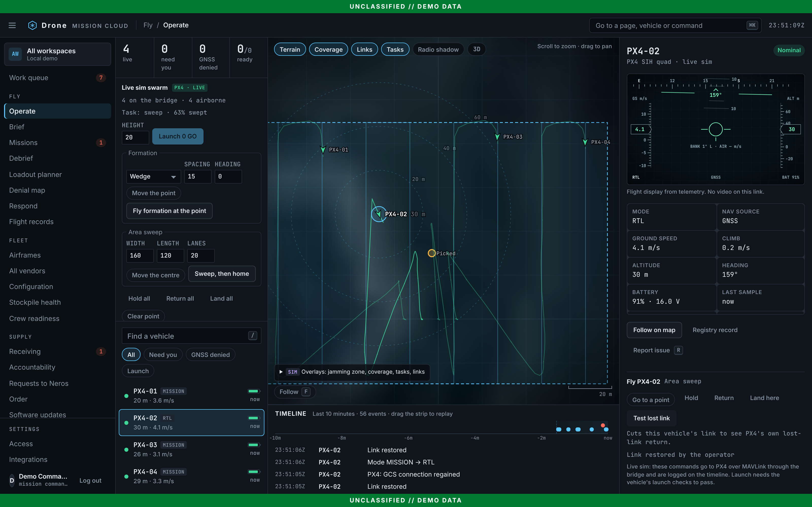
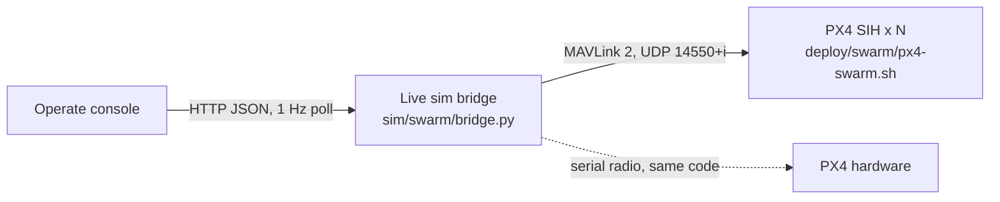

# Live sim: fly a PX4 swarm from Operate

Every fleet in the hosted demo is scripted. Live sim connects Operate to real PX4 flight software instead: several quadcopters flying in PX4's built-in simulator (SIH), reached over MAVLink through a small bridge. The same bridge flies PX4 hardware on a telemetry radio; only its endpoint list changes.

It is opt-in. Nothing in the hosted demo talks to a bridge unless someone opens the console with `?live=1` on a machine that runs one.



## Run it

You need Docker Desktop (Mac or Windows) or Docker (Linux), and Node 22 for the console. From the repository root:

```bash
make swarm-up                 # 4 PX4 quads in SIH and the bridge on http://localhost:8765 (first run downloads ~700 MB)
cd services/ui && npm ci && npm run build && npm run demo
# open http://localhost:4173/?live=1#operate
```

Then in Operate:

1. The rail shows **Live sim swarm** with four PX4 vehicles on the pad, each with its launch checks. Press **Launch 4 GO**. Each climbs to its own height (20, 23, 26, 29 m) so two that meet in transit are still apart vertically.
2. Pick a shape under **Formation** (line abreast, column, wedge, circle), press **Pick a point** and click the map, then **Fly formation at the point**. Each vehicle gets the slot that keeps the longest leg shortest, so paths do not cross. The slots show on the map.
3. Under **Area sweep**, pick the centre and press **Sweep, then home**. The area is split into one strip per vehicle, each flies its strip as a lawnmower mission, and PX4 brings each home when it finishes. The area, lanes and progress show on the map and in the rail.
4. Select a vehicle for its own controls: go to a point on the map, hold, return, land, and **Test lost link**, which cuts that vehicle's link at the bridge. About 10 s later PX4 turns for home on its own; restore the link and the console sees it already on RTL.

`SWARM_COUNT=6 make swarm-up` flies six (up to ten). `make swarm-check` flies the whole sequence headless and checks each step, and `make swarm-down` stops everything. Tick **Show the scripted demo fleet too** to see the swarm beside the scripted sortie; `?live=off` switches live sim off in that browser.

The hosted site can reach a bridge on your machine too (`https://drones.productexec.co/?live=1#operate` in Chrome, which asks once to allow access to your local network), but the local console is the dependable path.

## How it fits together



- **Simulator** (`deploy/swarm/px4-swarm.sh`, `docker-compose.swarm.yml`): N PX4 v1.18 instances in one container, each the real flight stack (commander, EKF2, position and attitude control, navigator) flying SIH's 6-DOF quad model. No Gazebo and no GPU, so four vehicles run on a laptop. The pad is at the demo range's station, so the console's terrain lines up. PX4 talks only to the first peer it hears on a UDP link, so each vehicle's ground link is pointed at the bridge's fixed address rather than learned; a restarted bridge picks up where it left off.
- **Bridge** (`sim/swarm/bridge.py`, Python and pymavlink): one link per vehicle. It keeps the newest state (position, height above home, speed, attitude, battery, mode, arming, landed state, GNSS fix and error), relays PX4's status text, and turns HTTP calls into MAVLink: arm and `NAV_TAKEOFF`, `DO_REPOSITION` for go-to and formation slots, a mission upload and `MISSION_START` for the sweep, `NAV_RETURN_TO_LAUNCH`, `NAV_LAND`, and hold. Each command waits for PX4's `COMMAND_ACK`, and the answer goes back to the console. It sets three PX4 parameters on connect and keeps setting them until PX4 echoes them: lost-link action return to launch, and a simulated pack that takes about 15 minutes to drain. It raises a separation alert when two airborne vehicles come within 4 m horizontally and 2.5 m vertically.
- **Geometry** (`sim/swarm/plan.py`): formation slots, slot assignment (exact for up to eight vehicles: minimise the longest leg, then the total), sweep strips and lanes, and per-vehicle height stagger. Pure functions with unit tests.
- **Console** (`src/livesim.ts`, `src/operate/LiveSim.tsx`): Operate polls the bridge beside the scripted telemetry and merges the live vehicles into the same fleet, so the list, the map, the flight display, the alerts (low battery, stale link) and the launch checks work on them unchanged. The swarm panel and each vehicle's Fly panel send commands; results and the bridge's own log land on the timeline.

### API

| Route | Does |
| --- | --- |
| `GET /v1/live/health` | Bridge up, vehicles configured and heard |
| `GET /v1/live/vehicles?since=<event id>` | `items` in the console's `LivePoint` shape plus `source`, `landed`, `link` and `task`; `platforms` registry rows; the swarm task with its slots or sweep area; events after the id |
| `POST /v1/live/command` | `{"tail", "action": "launch" \| "goto" \| "hold" \| "rtl" \| "land" \| "link", "alt_m", "lat", "lon", "on"}` |
| `POST /v1/live/swarm` | `{"task": "launch" \| "formation" \| "sweep" \| "hold" \| "rtl" \| "land", "tails", "alt_m", "shape", "spacing_m", "heading_deg", "lat", "lon", "width_m", "height_m", "lane_m", "then"}` |

Commands answer 200 when PX4 accepted them and 409 with PX4's answer when it did not. The bridge listens on 127.0.0.1 only and answers browsers only from `localhost`, `127.0.0.1`, `drones.productexec.co` and its Render previews. Commands are POST with `application/json`, which a browser cannot send cross-site without that check.

## Who can command

Live sim is the one place the console sends flight commands ([ADR 0027](../architecture/adrs/0027-live-sim-commands.md)). A role needs `vehicle.command` (mission commander, operator, admin); everyone else sees the swarm with the buttons disabled and the reason. Launch needs the vehicle's launch checks: the swarm launch sends only the vehicles that are GO, and a held vehicle's panel says which check failed.

## What was checked

- `make swarm-check` against four PX4 SIH vehicles, 2026-11-13: all four heard with a GNSS fix; launch to staggered heights in 17 s; line formation within 2.5 m of every slot in 5 s; a wedge 60 m north on a 45° heading in 18 s; PX4-01's link cut while holding, and on restore it was on RTL by itself (PX4 logged "Connection to ground station lost"); a 120 by 80 m sweep accepted by all four, half done in 31 s, and everyone home, landed and disarmed 74 s later.
- `sim/swarm/test_swarm.py`: geometry, the console data shape, CORS refusals, formation heights, the sweep mission ending in return to launch, launch only for vehicles on the ground, a cut link refusing commands (no PX4 needed; runs in CI).
- `services/ui/e2e/livesim.spec.ts`: the console against a stand-in bridge: no bridge calls without `?live`, launch sends only GO vehicles, a held vehicle shows why, formation at a picked point, go-to from the map, lost-link test, a role without `vehicle.command`, and no bridge running.

## Limits

- SIH is a rigid-body model on flat ground with no wind by default, perfect sensors apart from noise, and no collisions. Vehicles can pass through each other; the height stagger and the separation alert are the protection.
- The simulated pack recharges while disarmed. The energy model the scripted sortie uses (bingo, minutes home) is not applied to live vehicles yet.
- Commands are logged on the timeline, not in the hash-chained audit, and the role check runs in the browser. Both move server-side before anything flies outside a test range.
- The bridge decodes PX4 flight modes. ArduPilot speaks MAVLink too but numbers its modes differently and handles some commands differently; it would need its own mode table and testing.
- Missions, Fleet airworthiness and Debrief do not yet see live vehicles. The next step is to fly an approved plan's area from Missions as a sweep.

## Hardware that works with the same bridge

The bridge needs PX4 over MAVLink. Point `--vehicles` at each vehicle's radio (`serial:/dev/tty.usbserial-XXXX:57600`) or at a companion computer's UDP stream.

| Option | Why | Rough cost each (check the store) |
| --- | --- | --- |
| [Holybro PX4 Development Kit X500 v2](https://holybro.com/products/px4-development-kit-x500-v2) | PX4's reference airframe: Pixhawk 6C or 6X, GPS, a telemetry radio, outdoor. The default choice for a first hardware swarm. | About $600 to $1,000 with Pixhawk, GPS and radio; add batteries, charger and an RC transmitter |
| [ModalAI Starling 2](https://modalai.com/starling-2) | PX4 on VOXL 2 with visual-inertial navigation, flies indoors and without GNSS, Blue UAS. Closest to Neros-style GPS-denied work. | Low thousands of dollars |
| [ModalAI PX4 Autonomy Developer Kit](https://modalai.com/px4-autonomy-dev-kit) | The same VOXL 2 stack in the kit PX4 recommends for autonomy development. | Low thousands of dollars |

Bitcraze Crazyflie is the usual indoor swarm drone, but it runs its own firmware and radio protocol, not PX4 and MAVLink, so it would need a separate adapter rather than this bridge.

Before flying outdoors in the US: each aircraft over 250 g is registered with the FAA and broadcasts Remote ID, and under Part 107 one pilot flying more than one aircraft at once needs a waiver (otherwise one pilot per aircraft). Start with one vehicle, a tethered or netted test area, and the RC transmitter as the override.
